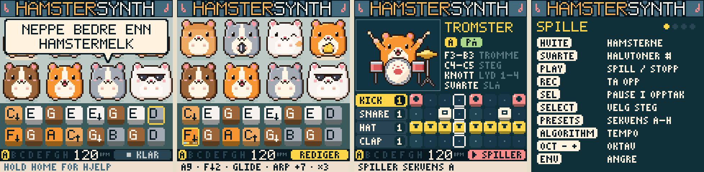

# HamsterSynth for M-VAVE FM-1

<p align="center"></p>

Nettsiden *Hamster Piano* (v4.17) som firmware for M-VAVE FM-1: de åtte hamsterne, 16-stegs sequenceren med åtte
sekvenser (A–H; siden har fire) og song, Tromster og THALLHAMSTERGRINDCORE. Bygget på Dinghy 0.5 (Felucca/SLOOP), med skjermfiksen fra Dinghy 0.6.1 for nyere FM-1-er.

**Nettsiden:** <https://joakimskurk.github.io/fm1hamstersynth/>. Der kan du prøve den i nettleseren, høre demoen og
installere den på FM-1.

<p align="center"></p>

> [!CAUTION]
> **Ikke prøvd på en ekte FM-1 ennå.** Bygget med JieLi-verktøykjeden, testet på vertsmaskin og kjørt i fm1-emu
> (FM-1-emulatoren), men ikke på en fysisk enhet. Installer på eget ansvar. Går noe galt: hold **OCT−** mens du slår
> på, så starter FM-1 i USB-redning, der en installer alltid virker.

**Hør den:** [hamster-demo.mp3](docs/hamster-demo.mp3) (57 s), eller på nettsiden, der hamsterne synger med. En sang i
A-moll på 128 BPM, med åtte sekvenser: en mørk intro som åpner seg, groove med LYS skrudd for hånd, en oppbygging med
ratchets, refreng, et utbrudd av THALLHAMSTERGRINDCORE og en drømmende slutt. Det er firmwarens egen kode som
spiller, kjørt på en datamaskin: `make demo` lager den på nytt (`tools/ham_demo.sh`, sangen i `tests/ham/demo_song.h`,
hva som trykkes når i `tests/scripts/ham/demo.txt`), også som video med skjermen (`build/demo/`).

## Hamsterne sier ting

Trykk **HOME**, så sier en av hamsterne noe. Mye av det er hentet fra
[Propanpedia](https://jhf.no/musikklubben/propanpedia/doku.php?id=hamster).

## Hva er prøvd, og hvordan

- **I fm1-emu (FM-1-emulatoren), med den ekte pakken:** hele panelet i én gjennomgang (`tools/emu_hamster.sh`). REC
  med tangenter og pause (SEL), markøren tilbake (SELECT), EDIT med knott 1 og 4 og OCT−, tempo (ALGORITHM), sekvens
  (PRESETS), PLAY, Tromster (SEQ, A3 velger hat, knott 3 lyden), THALL (FX), song-siden (hold GLO), stemmen (hold FX),
  hjelp (hold HOME), stopp og trommer for hånd. Hvert steg sjekkes på skjermbildet; lyden og hvor mye av brikken den tar
  (på det meste ca. 22 %) også.
- **På datamaskinen:** lyden mot nettsiden, og knappene, tangentene og MIDI gjennom skript (`tests/run_hamster.sh`).
- **Ikke prøvd på en ekte FM-1.** Emulatoren viser ikke lysene på tangentene og knappene, og den kjennes ikke som
  ekte dreieknapper. Plattformen under (Dinghy) er prøvd på FM-1: tangenter, skjerm, MIDI, installasjon.
- **Nyere FM-1-er** (med FM-1/M-VAVE-logoen under skjermen) fikk blek skjerm uten rødt, eller svart skjerm. Skjermen
  settes nå opp med M-VAVEs egne verdier, slik Dinghy 0.6.1 gjør (funnet av Jake Handy for h1). De første FM-1-ene ser
  ut som før.

## Bygge og installere

Enklest: installer fra [nettsiden](https://joakimskurk.github.io/fm1hamstersynth/#installer) (Chrome eller Edge,
Web MIDI). Eller selv:

```sh
./build.sh                                          # -> build/hamstersynth.fwsc (identitet FM-1_902)
python3 tools/fm1_install.py build/hamstersynth.fwsc   # spør før den skriver
make test                                           # testene på vertsmaskin (Python med numpy og Pillow)
make emu                                            # pakken i fm1-emu
make site                                           # nettsiden i build/site (med appen som WebAssembly)
```

Verktøykjeden (JieLi) og SDK-en: [docs/DINGHY_README.md](docs/DINGHY_README.md). CI bygger pakken på hver push
(artefaktet `packages`) og legger ut nettsiden fra `main`. En tagg `vX.Y` lager en utgivelse. SMK-37:
`./build.sh --board smk37`.

## Slik spiller du

| | |
|---|---|
| **Hvite tangenter** | Hamsterne. C4–C5 er de åtte; F3–B3 er de samme en oktav ned, D5–G5 en oktav opp. |
| **Svarte tangenter** | Halvtoner: hamsteren under tangenten, en halvtone opp (C♯, D♯, F♯, G♯, A♯). Den synger lysere, står på tå og glitrer. Tas opp som de hvite. |
| **PLAY** | Spill / stopp (sekvensen, eller songen når SONG er på). |
| **REC** | Stegopptak: hamsteren lagres i steget og går videre. **SEL** legger inn pause. Mens det spilles (sekvens eller song): tonen lagres i steget du hører den i, det nærmeste, runde etter runde. |
| **EDIT** | Rediger: en tangent bytter tonen uten å gå videre (når den står; mens den spiller tar tangentene opp, som REC). **SELECT** velger steg. |
| **SELECT** | Velg steg (og hør det). |
| **PRESETS** | Sekvens A–H. Mens den spiller: byttes ved neste runde. |
| **ALGORITHM** | Tempo, 50–220 BPM. |
| **OCT− / OCT+** | Tangentene en oktav ned / opp (i EDIT: stegets oktav, −3 … +1). |
| **ENV** | Angre (12 nivåer). Hold: slett lyd-opptaket i sekvensen. |
| **SEQ** | Tromster-siden (og trommene på). Hold: trommer av / på. |
| **FX** | THALLHAMSTERGRINDCORE av / på: −1 oktav, vreng, dobbelt tempo. Hold: hamsterstemmen eller sidens stemme. |
| **GLO** | SONG av / på. Hold: siden for song-rekkefølgen. |
| **HOME** | Hjem. Hjemme: skiltet sier noe nytt. Hold: hjelp på skjermen. |
| **SEL** (hold) | Slett sekvensen (ENV henter den tilbake). |
| **SAVE** | Lagre nå. (Den lagrer også selv, to sekunder etter siste endring, når ingenting låter.) |
| **SAVE** (hold) | Oppsett: KNOTT 1–4 er swing, hamsternivå, Tromster-nivå og MIDI-kanal. |
| **ARP** | Bytter linje: melodien (hamsterne) eller suben (den chubby med solbriller, bassen). Tangentene, REC og EDIT følger linjen du er på; begge spiller alltid. |
| **KNOTT 1–4** | Lyden: LYS, LENGDE, PIP, ROM (se under). Med REC mens den spiller tas de opp i sekvensen. |

**Lyden (KNOTT 1–4):** LYS gjør hamsterne mørkere, LENGDE gjør tonene kortere eller lengre, PIP gir mindre eller
mer pip og trille, og ROM gjør rommet tørrere eller større. I midtstilling (LYS helt opp) låter den som før. Skrur du
mens den spiller med REC på, lagres knottens stilling i hvert steg du hører den i, og i stegene som passerer mens du
skrur. De stegene får et grønt merke og spiller med sin egen lyd, mens de andre følger knottene. Uten REC endrer knottene
lyden for alle steg uten egen lyd. **Hold ENV** sletter lyd-opptaket i sekvensen (ENV henter det tilbake). Knottene går
også ut og inn som MIDI CC: 74 (LYS), 72 (LENGDE), 77 (PIP) og 91 (ROM).

**Suben:** den åttende hamsteren, den chubby med solbriller, har sin egen linje: 16 steg i hver sekvens, under
melodien, to oktaver ned, rund og dyp: nesten sinus, litt av andre overtone og bittelitt topp, en kort brumming og
et lite «hm!» ovenfra i anslaget, glide når glide er på. **ARP** bytter
mellom melodien og suben; i sub-visningen er stegene hvite på mørkt og det står SUB nederst. Alt annet virker som i
melodien: tangentene (også de svarte), REC og EDIT (uten arp), ENV, SEL. Melodiens høye C synger nå den gylne, en
oktav opp. Suben går ut på MIDI-kanalen etter melodiens.

**I EDIT:** KNOTT 1 glide, KNOTT 2 arp (+7, +12), KNOTT 3 accent, KNOTT 4 ratchet (×1–×4).
**SEL** sletter steget, **SAVE** kopierer det til neste, **LFO** lager en tilfeldig sekvens.

**På Tromster-siden:** F3 G3 A3 B3 velger kick, snare, hat, clap; C4–C5 setter de åtte stegene (lysene viser dem);
de svarte C♯4 D♯4 F♯4 G♯4 spiller kick, snare, hat og clap for hånd;
KNOTT 1–4 velger lyd 1–4 for hver tromme (1–3 er sidens, 4 er hamstersettet: kinnpop, frøknas, snus og pip); hold SEL
sletter raden.

**På song-siden:** de åtte hamstertangentene C4–C5 skriver A–H ved markøren, SELECT flytter den, PRESETS bytter bokstaven, SEL sletter.

**Stegene på skjermen:** en flis i fargen til hamsteren som synger, med tonen (♯ for halvtone) og pil for oktav;
på foten små merker: blå = glide, gul = arp (oransje = +12), rosa = aksent, streker = ratchet. Grønn fot: steget har
sin egen lyd (knottene, tatt opp).

**Lys:** de åtte hamstertangentene gløder, den som synger lyser (en halvtone: dens svarte tangent). PLAY blunker på slaget; REC, EDIT, SEQ (trommer på),
FX (THALL) og GLO (SONG) lyser når de er på.

## Valg som er tatt for FM-1

- **Tangentene bærer oktaven.** Siden har åtte knapper og egne oktavknapper per steg. FM-1 har 16 hvite tangenter, så
  de ytterste spiller de samme hamsterne en oktav ned og opp, og oktaven følger med inn i steget.
- **Stegeffektene er alltid tilgjengelige.** På siden vises glide, arp, accent og oktav bare i THALL-modus; her ligger
  de på knottene i EDIT uansett.
- **Sequenceren teller lydrammer**, ikke en nettlesertimer: et steg er 30 / BPM sekunder på rammen, ratchets på sine
  delinger.
- **Sekvensbytte mens det spiller** skjer ved neste runde i stedet for å stoppe.
- **WAV-eksport** er USB-lyden: FM-1 dukker opp som lydinngang (44,1 / 48 kHz), ta opp det den spiller.
- **Nytt:** halvtoner på de svarte tangentene, trommer for hånd på Tromster-siden, lyd-knottene, swing, egne nivåer for hamstere og Tromster, MIDI inn (noter,
  klokke, start / stopp) og ut (hamsterne på valgt kanal, trommene på kanal 10), alt lagres i flash.

## Figurene

Hamsterne og trommehamsteren er tegnet på nytt som pikselkunst i `tools/ham_sprites.py`, med samme kjennetegn som på
siden: den gylne, den grå med solsikkefrø, den hvite som blunker, den oransje med ost, den brune, den oransje med tunga
ute, den grå som smiler med lukkede øyne og den hvite med solbriller. (A og B har byttet plass fra siden, og den grå
som smiler har ikke lenger frø: to like grå hamstere med frø var én for mye.) Én blekkfarge for omrisset og lys fra øvre
venstre hjørne. Hver figurpiksel er 2×2 skjermpiksler, som logoen og teksten.

## Skjermen

- **To fonter:** store bokstaver for det viktigste (tonene, tempoet, titlene), en liten pikselfont (med ÆØÅ) for det
  som sies ved siden av: status, hint, merkelapper og hjelp.
- **Hamsterne** sitter på et dust salviegrønt gulv, hver med sin skygge, uten rammer og uten bokstaver (tonene står i
  stegene). Den valgte har varm skygge, den som synger rosa. Hver hamster har fire positurer, tegnet piksel for piksel
  (ingen skalering, så omrisset er alltid like tykt): i ro; en tone, munnen åpen og en piksel lavere; en halvtone,
  den dukker også, men med ørene opp, øynene klemt igjen (> <) og munnen vid, og stjerner i hjørnene (potene blir der
  de er: noen holder maten sin); THALL, klemt flat. I THALL er gulvet mørkt.
- **Stegene** står i slag på fire, som fliser i fargen til hamsteren som synger dem: tonen stor, ♯ og oktavpil ved
  siden av, effektene på foten (glide blå, arpeggio gul eller oransje, aksent rosa, ratchet som streker). Grønn fot: egen
  lyd. En pause er en prikk. Markøren er gul, steget som spilles hvitt.
- **Bunnen:** sekvensene A–H i hver sin farge (de samme i songen): den som vises fylt, de med noter i farge, de tomme
  dempet; tempoet og hva den gjør. Under
  står det som akkurat skjedde i et par sekunder, ellers et hint for det du holder på med. I REDIGER sier den steget i
  ord: «A9 · F↓2 · GLIDE · ARP +7 · ×3».
- **Skiltet** er en snakkeboble fra en av hamsterne (mørk i THALL). Den går bort så snart du gjør noe.
- **Hjelpen** (hold HOME): fire sider, knappene tegnet som taster.

## Hamsterstemmen

Standardstemmen er firmwarens egen, mer hamstrete enn sidens (hold **FX** for å bytte til sidens):

- **Hver tone piper:** den starter med et lite kvitter ovenfra og vokalen «i», synger sin egen vokal og lukker seg
  med «u», litt lavere.
- **Hver hamster har sin stemme:** størrelse (formantene), vokal, trille og hvor mye den piper. Den hvite piper mest,
  den brune er dypest, den med ost har munnen full, den med solbriller er kul og rolig.
- **Rikere klang:** opptil 24 overtoner i stedet for 8, så de små hamsterstrupenes høye formanter høres.
- **Ryddigere:** tonens lengde følger tempoet, så raske sekvenser ikke flyter sammen. Hamsterne sitter fra venstre til
  høyre i stereo, slik de sitter på skjermen, i et lite rom med noen få refleksjoner.
- **Hamstersettet** i Tromster (lyd 4 på hver tromme): kinnpop, et frø som knaser, et snus og et pip.

Lyddemoen bruker hamsterstemmen. `tools/ham_demo.sh` lager også samme demo med sidens stemme
(`build/demo/hamstersynth-demo-side.mp3`) til sammenligning.

## Sidens stemme

Siden bygger hver tone av Web Audio-noder. Her, i heltall (`firmware/src/ham_engine.h`):

- **En hamster** er en bølgetabell med de åtte overtonene slik de tre formantfiltrene og lavpassfilteret etterlater
  dem på akkurat den tonen (`tools/gen_ham_tables.py` regner filtrene ut, én tabell per tone), kroppens sinus ved
  siden av, pust (filtrert støy) og rommets ekko. Under glide regnes hver overtone gjennom formantene der den er.
- **THALL** går gjennom sidens forvrengning (kurven, fire ganger oversamplet) og kabinettfiltrene, én stemme om gangen.
- **Tromster**: kick, snare, hat og clap med tre lyder hver.
- Omhyllingskurvene er linjer i logaritmen, altså Web Audios eksponentielle ramper.

Sidens stemme er beholdt som den var. Mot sidens egen gjengivelse (`tools/ham_ref.js` lar siden rendre testtilfellene; `tests/ham/parity.py` sammenligner
energien i tersbånd over tid): hamsterne innenfor ca. 0,2–0,5 dB i snitt, THALL 0,4–0,6 dB, trommene ca. 1,4 dB
(støy er aldri lik to ganger). Referansen er instrumentet slik det spilles live: sidens WAV-eksport starter noter
midt i en lydblokk, og da begynner Chromiums oscillatorer på feil tonehøyde et øyeblikk, som endrer forvrengningen i
THALL. Den særheten er ikke portet.

Hamsterstemmen testes for nivå (like sterk som sidens innenfor 2 dB) og at ingenting klipper. I fm1-emu bruker
lydavbruddet på det meste ca. 22 % av tiden det har.

## Hva er hvor

| | |
|---|---|
| `firmware/src/hamster.c` | Appen: tangenter, knapper, sider, lagring, MIDI |
| `firmware/src/ham_engine.h` | Lyden og sequenceren (lydavbruddet) |
| `firmware/src/ham_draw.h` | Skjermen |
| `firmware/gen/ham_tables.h`, `ham_art.h` | Laget av `tools/gen_ham_tables.py` og `tools/gen_ham_art.py` (`--sheet FIL.png` viser alle figurene) |
| `tools/ham_sprites.py` | Hamsterne og trommehamsteren, tegnet piksel for piksel (26×27 og 56×45, vist 2×2) |
| `tests/run_hamster.sh`, `tests/ham/`, `tools/emu_hamster.sh` | Testene |
| `tools/ham_demo.sh`, `tests/scripts/ham/demo.txt`, `tests/ham/demo_song.h` | Lyddemoen: hva som trykkes når, og sangen den spiller (bare i demobygget) |
| `web/index.html`, `web/make_site.py`, `web/make_og.py` | Nettsiden: installeren og bildene |
| `web/app/` | HamsterSynth i nettleseren: firmwaren kompilert til WebAssembly (`build.sh`), lydtråden (`worklet.js`), panelet (`hamster.js`) |
| `firmware/hal/`, `firmware/loader/`, `firmware/src/platform.c` … | Plattformen, Dinghy 0.5 ([PLATFORM.md](PLATFORM.md)) |
